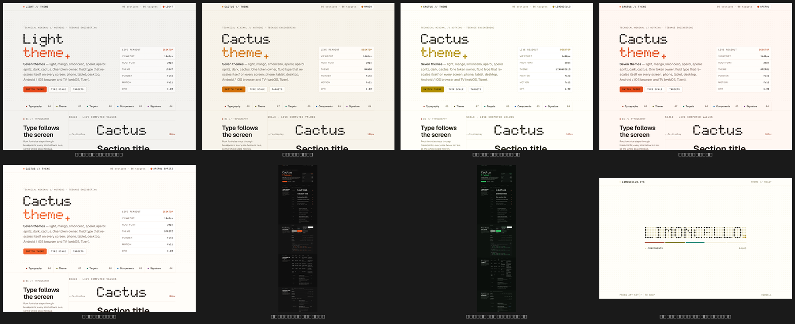
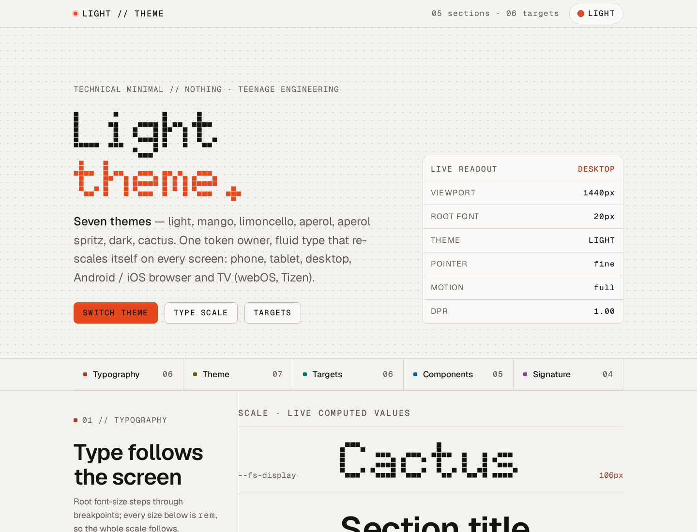
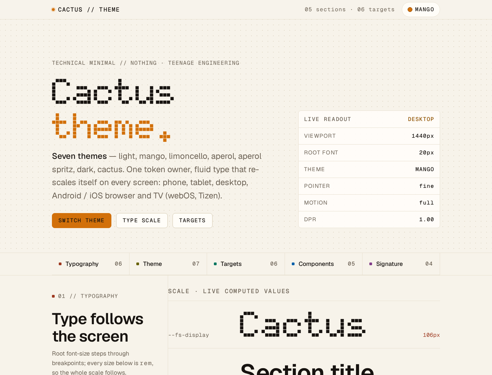
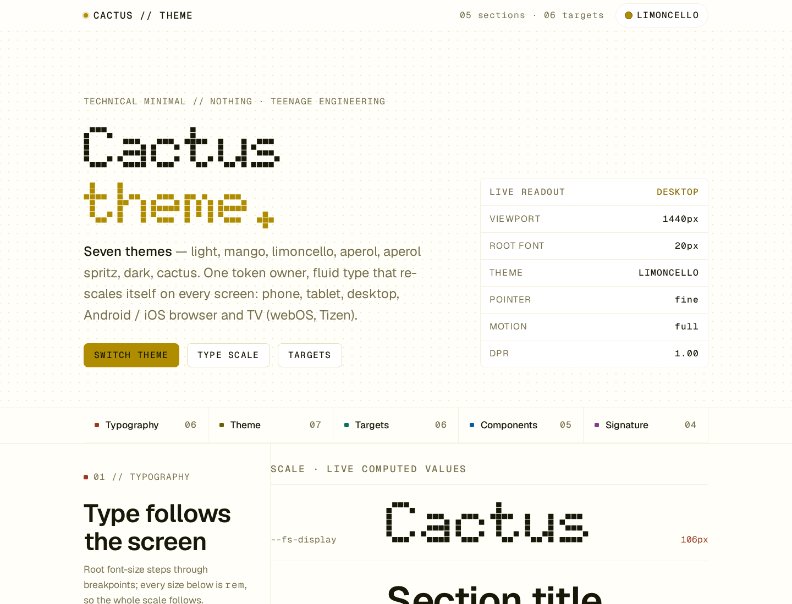
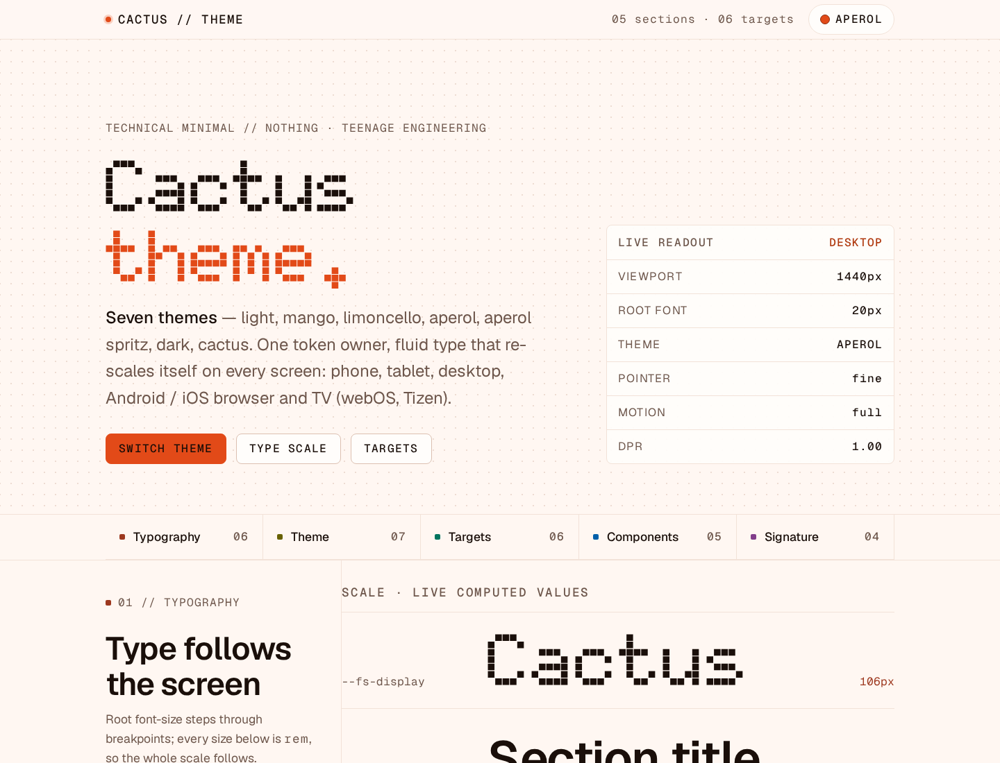
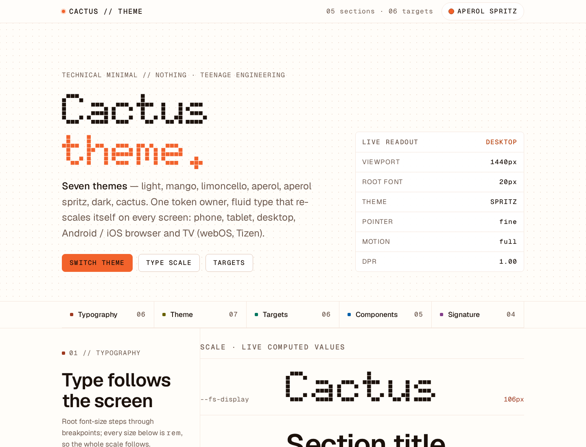
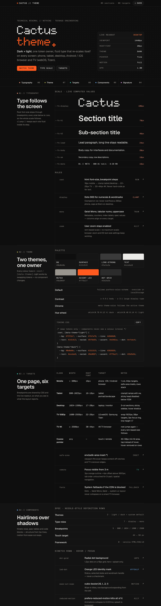
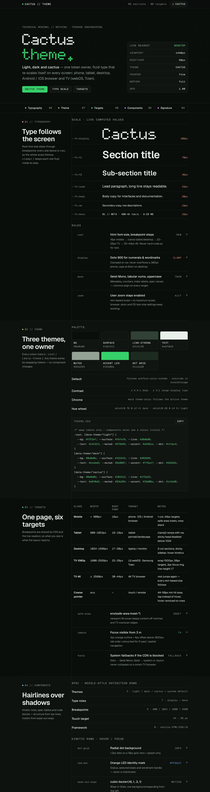
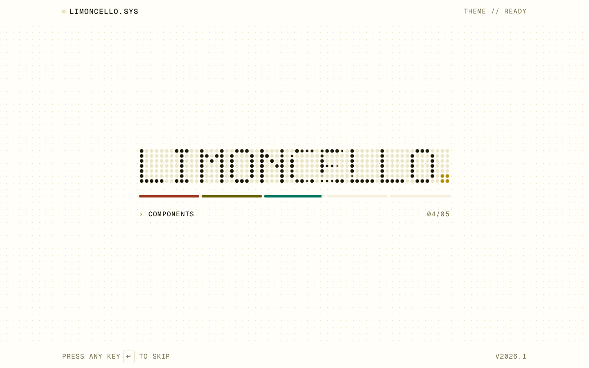

# Cactus — Technical Minimal theme pack

A single-file, framework-free implementation of the **Technical Minimal** design language
(Nothing / Teenage Engineering aesthetic, after [mich-de.github.io](https://mich-de.github.io)):
hairline grids, radial dot grid, orange LED accent, mono index labels, kinetic rows —
plus **seven switchable themes** and **fluid typography that re-scales itself on every screen**.

Open [`index.html`](./index.html) in a browser. That's the whole demo.



---

## Themes

Seven themes, one token owner. Every colour lives in `:root` / `[data-theme="…"]`;
components never contain a colour literal, so a new theme is one CSS block.

| Key | Name | Character | bg | accent (LED) |
| --- | --- | --- | --- | --- |
| `light` | Light | neutral warm paper | `#f3f2ef` | `#e5481a` |
| `mango` | Mango | warm cream, amber LED | `#f7f3ea` | `#d2700a` |
| `limoncello` | Limoncello | brightest lemon paper | `#fffef9` | `#b08d00` |
| `aperol` | Aperol | peach paper, red-orange | `#fff7f2` | `#e24a18` |
| `spritz` | Aperol Spritz | near-white fizz | `#fffdf9` | `#f2622b` |
| `dark` | Dark | graphite | `#0e0e0e` | `#ff5a1f` |
| `cactus` | Cactus | green-black, green LED | `#0a0e0b` | `#35d06a` |

- **Default** follows `prefers-color-scheme`, then persists in `localStorage`.
- **Switch** from the top-bar pill, the hero button, or the seven theme pills in section 02.
  The cycle is `light → mango → limoncello → aperol → spritz → dark → cactus`.
- **Contrast**: body text ≥ 4.5:1, display type and accents ≥ 3:1, text on accent fills ≥ 5:1.
  Light accents are capped at the brightest value that still passes 3:1 against the paper.

### Everything that changes with the theme

One `sync()` call updates all of it — nothing is hard-coded in the markup:

- background, hairlines, dot grid, LED accent, section hue lightness
- `<h1>` ("Limoncello theme."), top bar ("LIMONCELLO // THEME"), splash header ("LIMONCELLO.SYS")
- `<title>`, footer, live readout, toggle label, active pill, `<meta theme-color>`
- the boot splash dot-matrix word itself (re-spelled at load for the active theme)

---

## Fluid typography — one scale, every screen

`html { font-size }` steps through breakpoints; every role (`--fs-display` … `--fs-mono`) is
defined in `rem` with a `clamp()` inside its step, so the whole scale follows the device —
and browser zoom / OS text-size settings keep working.

| Class | Width | Root font | Typical target |
| --- | --- | --- | --- |
| Mobile | < 600px | 16px | phone, iOS / Android browser |
| Tablet | 600–1023px | 16–18px | tablet portrait / landscape |
| Desktop | 1024–1599px | 17–20px | laptop / monitor |
| TV 1080p | 1600–2559px | 22–26px | LG webOS, Samsung Tizen (10-foot UI) |
| 2K / 4K | ≥ 2560px | 26–34px | large displays |

TV extras: 1500px measure, 56px touch/remote targets, 3px focus ring visible from 3 m,
`line-height: 1.7`, `env(safe-area-inset-*)` for notches and overscan.

The **live readout** panel in the hero reports the current viewport width, active
breakpoint, root font size, theme, pointer type, motion preference and DPR — it is driven
by the same breakpoint names the CSS uses.

---

## Features

- **Dot-matrix boot splash** on every page load — 5×7 glyphs rendered at runtime from the
  active theme name ("CACTUS.", "APEROL SPRITZ."), segmented hue progress bar, blinking LED,
  skip on any key / tap / scroll, 6s hard fallback, bypassed for `prefers-reduced-motion`.
- **Index quick-nav** with per-section hue swatches and tabular counts.
- **Two-column sections**: sticky technical head (`01 // TYPOGRAPHY`) + kinetic rows whose
  background wipes in from the left with `cubic-bezier(.16, 1, .3, 1)`.
- **Per-section OKLCH hue wheel** (`h = 35 + i × 360 / n`): swatches, index labels, focused
  row titles, splash progress segments — never body text.
- **Spec tables, palette grid, code block with copy button**, all hairline-only (no shadows).
- **Vanilla only**: no framework, no build step, no tracking. Works with JS disabled
  (static markup + light theme fallback).
- **Accessible**: skip link, visible focus, ≥ 4.5:1 contrast, 44–56px touch targets,
  reduced-motion support.

---

## Quick start

```bash
git clone https://github.com/mich-de/technical-minimal-web_2.0.git
cd technical-minimal-web_2.0
python3 -m http.server 8000   # or just open index.html
```

### URL parameters

| Param | Effect |
| --- | --- |
| `?theme=light\|mango\|limoncello\|aperol\|spritz\|dark\|cactus` | deep-link a theme |
| `?nosplash=1` | skip the boot splash (print / screenshots) |
| `?noanim=1` | freeze all animations (print / screenshots) |

### Use it on your own page

Copy the token block from the `tokens.css` snippet in section 02 (or from `<style>` in
`index.html`), keep `font-size` in `rem`, and set colours only through the variables.
Fonts: **Doto** (display), **Geist** (sans), **Geist Mono** (metadata) via Google Fonts,
with system fallbacks so a blocked CDN never breaks the layout.

---

## Gallery

| | |
| --- | --- |
|  |  |
|  |  |
|  |  |
|  |  |

Responsive proofs: [`shots/`](./shots) — 390px, 834px, 1440px, 1920px, 2560px,
dark / light / cactus, full-page captures.

---

## Structure

```
index.html      # everything: tokens, layout, splash, theme engine (single file)
shots/          # verification screenshots (viewports × themes) + contact sheet
README.md
```

Design language and templates: the `technical-minimal-web` skill.
Fonts © their respective authors (Doto, Geist — Google Fonts, OFL).
